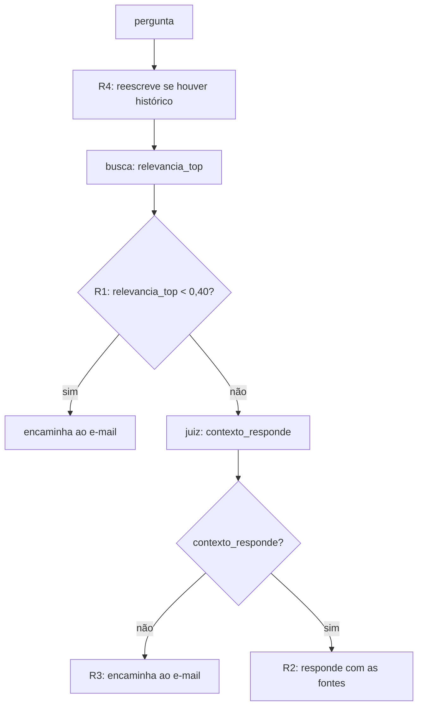

# Regras e motor de inferência

Projeto: Assistente de IA Caça Asteroides MCTI
Disciplina: Inteligência Artificial e LFA, Profa. Kadidja Valéria (UDF)
Integrantes: Luís Filipe Silva Santos e Luana Stoinski

## 1. O problema

O Caça Asteroides MCTI é um programa de ciência cidadã do MCTI e da AEB, em parceria com o IASC/NASA. Equipes de professores e estudantes analisam imagens astronômicas reais em busca de asteroides.

A coordenação recebia por e-mail as mesmas dúvidas muitas vezes: como se inscrever, prazos do edital, erros no software Astrometrica, quem recebe certificado. O assistente resolve essas dúvidas a partir do material oficial. Quando a resposta não está no material, ele não responde: encaminha a pessoa para o e-mail da coordenação.

O sistema está em uso pelos participantes em https://caçaasteroides.app.

## 2. Por que é um sistema especialista

| Componente | No projeto |
|---|---|
| Especialista de domínio | A coordenação do programa. O conhecimento veio do edital e dos materiais oficiais. |
| Base de conhecimento | `backend/data/*.json`: edital, fluxo do participante, erros frequentes (sintoma, causa e solução), certificados, contatos. |
| Regras SE–ENTÃO | `backend/services/decision.py` e `backend/services/grader.py` |
| Motor de inferência | `backend/services/pipeline.py` |
| Interface | Chat em `frontend/` |

A base fica separada do motor. Quando o edital muda, atualizo os JSON e reindexo; as regras e o motor continuam iguais.

O sistema não apenas busca texto. Antes de responder, ele decide se tem base suficiente para isso, e essa decisão é feita por regras.

## 3. Fatos

| Fato | Valor | Origem |
|---|---|---|
| `pergunta` | texto | usuário |
| `tem_historico` | sim / não | conversa anterior |
| `relevancia_top` | 0 a 1 | busca semântica: o quanto o melhor trecho oficial se parece com a pergunta |
| `contexto_responde` | sim / não | juiz: os trechos encontrados respondem mesmo à pergunta? |

## 4. Regras

### Regras de decisão

| | SE | ENTÃO | Código |
|---|---|---|---|
| R1 | `relevancia_top < 0,40` | fora do escopo: não responde e encaminha ao e-mail da coordenação | `decision.py`, linhas 5 e 11–13 |
| R2 | `relevancia_top ≥ 0,40` E `contexto_responde = sim` | responde usando somente os trechos oficiais | `pipeline.py`, linha 94 em diante |
| R3 | `relevancia_top ≥ 0,40` E `contexto_responde = não` | informação ausente: não responde e encaminha ao e-mail | `pipeline.py`, linhas 94–101 |

### Regras de apoio

| | SE | ENTÃO | Código |
|---|---|---|---|
| R4 | há mensagens anteriores na conversa | reescreve a pergunta para que faça sentido sozinha ("e como faço isso?"); sem histórico, usa a pergunta original | `rewrite_query.py`, linhas 36–37 |
| R5 | um trecho tem relevância < 0,40 | o trecho não é usado na resposta (máximo de 3 trechos) | `grader.py`, linhas 26–27 e 53–55 |
| R6 | a busca falha ou não encontra nada | não responde e encaminha ao e-mail | `decision.py`, linhas 8–9; `pipeline.py`, linhas 50 e 59 |
| R7 | o juiz fica indisponível | segue com a R1 e com a resposta restrita às fontes, para o atendimento não parar | `grader.py`, linhas 114 e 127 |

## 5. Motor de inferência

O motor faz encadeamento para frente: cada etapa produz um fato, e a regra que depende dele é testada em seguida.



### Por que existem duas regras antes de responder

A R1 sozinha não basta. Uma pergunta como "asteroide é a mesma coisa que cometa?" usa as palavras do programa, então a relevância fica alta, mas o material não compara asteroide com cometa.

Para esse caso existe o juiz: um modelo de linguagem (gpt-4o-mini, temperatura 0) que lê a pergunta e os trechos, escreve um raciocínio curto e responde só "sim" ou "não". Esse veredito vira o fato `contexto_responde`. Quem decide são as regras R2 e R3; o modelo apenas informa um fato.

É a mesma ideia dos fatores de certeza do MYCIN: o sistema só recomenda quando a evidência é suficiente.

## 6. Exemplos de raciocínio

"Quem tem direito ao certificado?"
relevância ≥ 0,40 → R1 não dispara → juiz: sim → R2 → responde com base no edital.

"Asteroide é a mesma coisa que cometa?"
relevância ≥ 0,40 → R1 não dispara → juiz: não → R3 → encaminha ao e-mail.

"Qual o melhor time de futebol?"
relevância < 0,40 → R1 → encaminha ao e-mail, sem chamar o juiz.

Cada pergunta recebe um `request_id`, e o log mostra qual regra disparou e o motivo do juiz:

```
[DECISION BLOCK] top_cos=0.312 < 0.4
[GRADER] veredito=RECUSA | motivo='...'
```

## 7. Calibração

O limiar 0,40 e o juiz foram ajustados com 89 perguntas rotuladas (`backend/tests/dataset.py`):

| Tipo | Qtd. | Esperado |
|---|---|---|
| Dentro do escopo | 61 | responder |
| Adversariais (palavras do programa, sem resposta no material) | 12 | encaminhar |
| Fora do escopo | 10 | encaminhar |
| Dependem da conversa | 6 | responder |

- `tests/eval_floor.py` testa limiares de 0,30 a 0,55 e mostra, em cada um, quantas perguntas válidas passam e quantas indevidas são barradas.
- `tests/eval_grader.py` avalia o juiz e mostra, em cada erro, o que ele recebeu.
- `tests/eval_gate.py` avalia o limiar e o juiz juntos, como funcionam em produção.
